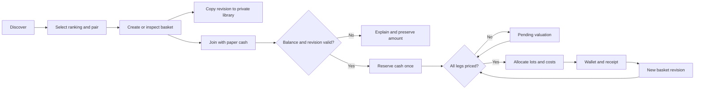
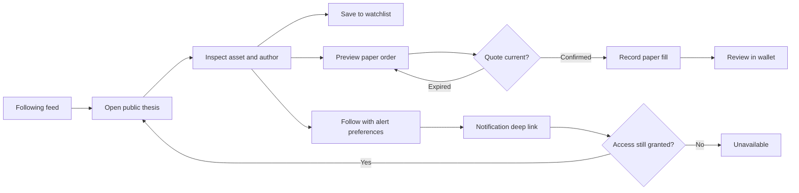
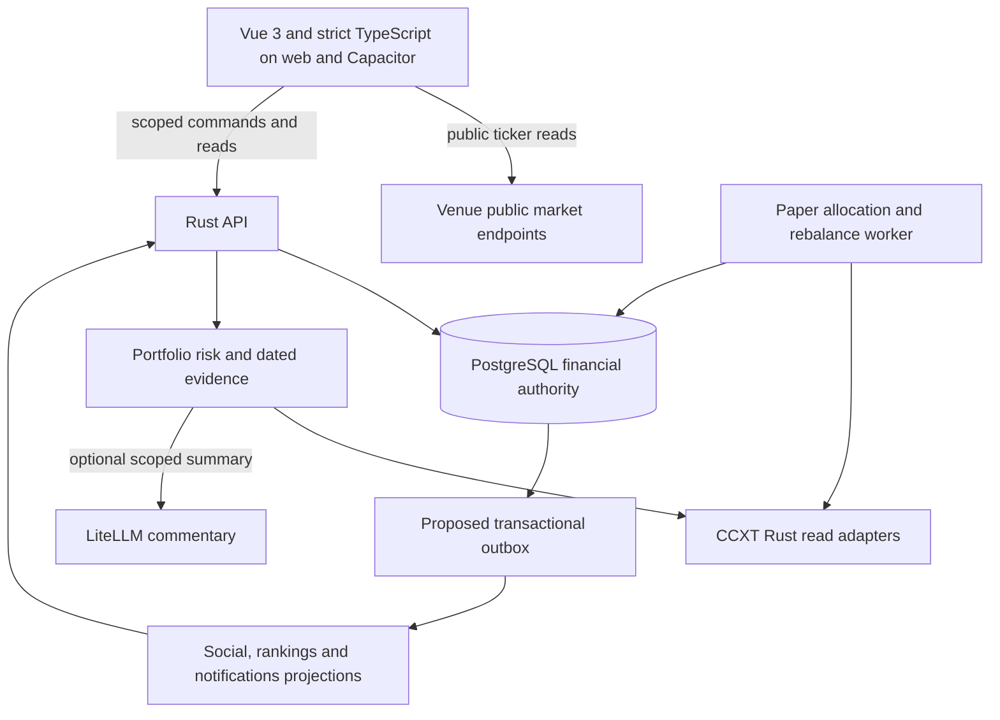

# Oracle consumer platform blueprint

Reviewed on 22 November 2026. This specification covers the discovery-to-paper-investment journey on web, iOS and Android. The first customer is an Eighred research operator. A member can investigate an instrument, copy a portfolio idea, commit virtual cash, inspect the resulting quantities and reconcile the outcome. The social network, production identity and funded execution are subsequent product decisions.

## 1. Fomo functionality report

**Evidence method.** We opened the public sites in Chromium at 1440 and 390 CSS pixels wide, examined the rendered navigation and controls, and opened the login and search entry points. We also captured the public Fomo movers page and OpenSea home viewport using REA. The captures are research material outside the product. In the table, **observed** means visible in a public page. **Documented** means the publisher describes the signed-in or native behavior. The signed-out Discover route did not expose the member workspace in this inspection. No account, wallet, deposit or order was created. Dependencies below describe the information the interaction requires. They do not identify Fomo's private services.

| Surface and purpose | Behavior, interaction and dependency | Evidence |
|---|---|---|
| Landing and navigation | Crypto expands to gainers, losers, new assets and the price directory. Perps, editorial content, resources, login and app download are separate entry points. Login opened a choice of Apple or Google. Public browsing requires no session. | Observed · [Home](https://fomo.family/) |
| Market discovery and search | Switch market views, search within the selected view by name or symbol, sort a column and open an asset. The gainers view displayed 20 assets, positive 24h moves, prices and Buy actions. Mobile replaced table headings with a sort control, stacked summary rows and expandable details. Rows depend on price coverage and network identity. | Observed · [Gainers](https://fomo.family/top-movers), [price directory](https://fomo.family/prices), [new assets](https://fomo.family/new) |
| Trending and advanced exploration | Member Discover opens on Trending. Lists also cover crypto, holdings popularity, graduated and bonding tokens, and favorites. The user chooses timeframe, filters and columns, or compares two independently configured tables. Available fields vary by list. The publisher does not disclose a complete trending formula here. | Documented · [Web Discover](https://help.fomo.family/en/articles/18098507-discover-on-the-fomo-web-app) |
| Token details and identity | Bitcoin's public price page displayed a price and change, a Buy action, valuation, volume, liquidity, supply, a network ID and a token address. A ticker alone cannot identify the underlying instrument. | Observed · [Bitcoin price page](https://fomo.family/prices/bitcoin-btc) |
| Charts and market context | Signed-in web Discover can open a floating token window with chart, holders, theses and swaps. The publisher documents average entry overlays. Perpetual market charts add liquidation levels and can display an order book. These require different data from a ticker snapshot. | Documented · [Release notes](https://fomo.family/release-notes), [web platform](https://help.fomo.family/en/articles/17831976-using-fomo-on-the-web) |
| Buy, sell and trade review | A regular mobile trade has a confirmation gesture. Quick Trades accepts a cash preset to buy or a percentage of held quantity to sell. Minimum size, cash, price impact and asset eligibility affect availability. Web uses the token trade panel and a separately configured quick buy in Discover. The public Buy button alone supplies no fill evidence. | Documented · [Quick Trades](https://help.fomo.family/en/articles/17831974-quick-trades-trading-in-one-tap), [web Discover](https://help.fomo.family/en/articles/18098507-discover-on-the-fomo-web-app) |
| Sign-in, wallets and funding | Apple or Google identity opens the same account on supported devices. Fomo describes creating Solana and EVM wallets during onboarding. Its web guide distinguishes crypto transfers from mobile card and bank flows. We did not establish a generic external-wallet connector from these sources. | Login choice observed, wallet provisioning documented · [Account creation](https://help.fomo.family/en/articles/14430434-creating-your-fomo-account), [web platform](https://help.fomo.family/en/articles/17831976-using-fomo-on-the-web) |
| Profile, holdings and history | Mobile profile groups open and closed positions, shows range-specific P&L and links to a filterable account history. A position opens entry, quantity and proceeds. On web the clock leads to transfers and the positions table holds trades. These surfaces need dated balances and attributed fills. | Documented · [History](https://help.fomo.family/en/articles/14436332-transaction-history) |
| Feed, follows and research posts | Global and Following select the audience. A trade or thesis opens a detail view, and a trader opens a profile. Following changes the personalized feed. On web a trader hover card also offers Follow. A thesis can attach to a held position and appear on token, profile and feed surfaces. | Documented · [Feed](https://help.fomo.family/en/articles/14436836-the-social-feed), [following](https://help.fomo.family/en/articles/14436869-following-other-traders), [theses](https://help.fomo.family/en/articles/14436863-posting-a-thesis) |
| Rankings and groups | Select a time window and trader to inspect performance. Traders, positions and clans have different populations. The positions board includes profitable fully closed positions and can filter by invested amount. Mobile includes clans. This selection matters when interpreting returns. | Documented · [Leaderboard](https://help.fomo.family/en/articles/14436887-leaderboard), [positions](https://help.fomo.family/en/articles/17983941-the-positions-leaderboard), [clans and features](https://help.fomo.family/en/collections/19294006-features) |
| Favorites and hiding | A star adds a token to the watch strip and watchlist. The web row menu can hide and restore a token. Discover visibility and hidden holdings have separate meanings. The release notes describe drag reordering. | Documented · [Discover controls](https://help.fomo.family/en/articles/18098507-discover-on-the-fomo-web-app), [release notes](https://fomo.family/release-notes) |
| Notifications | Users configure price, following and trending alerts. The mobile notification center opens the associated conversation, follower or invitation. Delivery depends on identity, settings and device permissions. Private payloads and delivery latency were not tested. | Documented · [Notifications](https://help.fomo.family/en/articles/14436883-notifications), [release notes](https://fomo.family/release-notes) |
| Mobile navigation and settings | The publisher describes five bottom destinations for home, search, feed, rankings and portfolio. Search supports tokens, addresses, traders and clans. Settings include language, security, notifications and support. Native layout was not inferred from the public mobile webpage. | Documented · [Mobile navigation](https://help.fomo.family/en/articles/14430486-navigating-the-app) |
| Adjacent product lines | The public navigation and guides advertise perpetuals, creator programs, referrals and teams. Their economics, eligibility and margin models require separate qualification. A Fomo clan is a social group. The public evidence does not establish Oracle-style funded basket subscriptions. | Observed navigation and documented features · [Perpetuals](https://fomo.family/perpetual-futures), [feature index](https://help.fomo.family/en/collections/19294006-features) |

## 2. OpenSea visual and interaction report

| Surface | Public observation or reference | Oracle design decision |
|---|---|---|
| Shell and hierarchy | The desktop homepage captured during review used a horizontal header, category pills, a large image-led feature on the left, a compact ranking rail on the right and a token shelf below. At phone width the main feature remained prominent and ranking content moved into the vertical flow. [Home](https://opensea.io/) | Give Discover an illustrated lead surface and a separate scanning surface. Retain the workstation rail for existing report users. On mobile, use swipeable cover cards, section switching and a persistent bottom dock. |
| Search and overlays | Opening Search produced a text input and grouped suggestions for several asset types. The token directory also has a context-specific chain search. [Home](https://opensea.io/), [token directory](https://opensea.io/tokens) | Keep scope visible. The pilot header searches spot pairs. A later global dialog groups instruments, baskets and people, preserves the return route, traps focus and closes with Escape. |
| Color, typography and spacing | The dark marketplace canvas gives images priority. Pricing and change sit close to their labels. The supplied Refero study specifies near-black layers, cool blue emphasis, mono figures, small corners and tight spacing. Its icon-rail layout is a separate reference from the live homepage header. [Refero style study](https://styles.refero.design/style/61f1902f-6da3-4af7-b046-3b08bc1377f6) | Use the supplied [design tokens](../../web/DESIGN.md). Use system fallbacks for unlicensed font families. Keep white labels, numeric alignment, signed changes and blue focus emphasis. Eighred owns its mark, cover art and names. |
| Cards and grids | A featured item's title and metadata overlay imagery. Smaller entries pair identity with a value and delta. Separate sections distinguish editorial picks, trending tokens and movers. [Home](https://opensea.io/) | Each Oracle cover links to one ranking and names its leading eligible pair. A cleared feed displays a missing-data state. An official basket pin requires an actual curator decision. |
| Tables, buttons and filters | The tokens table groups identity, value, change across periods and volume. Chain choices, cap bands and categories narrow the result. Activity has event controls and participant/time columns. [Tokens](https://opensea.io/tokens), [activity](https://opensea.io/activity) | Keep one unit per numeric column. Place source, timeframe and ranking basis beside the data. Give refresh, filters and row actions accessible names. Use a labeled mobile disclosure for secondary facts. |
| Hover, focus and dialogs | Refero describes tinted hover surfaces and inset rings. The observed global search opened an overlay. Other authenticated dialog states were outside this inspection. [Style reference](https://styles.refero.design/style/61f1902f-6da3-4af7-b046-3b08bc1377f6), [home](https://opensea.io/) | Hover can reveal emphasis. All actions must work with tap and keyboard. Show pressed state on filters, restore focus after dismissing a sheet, honor reduced motion and keep stale/error labels visible without color. |

## 3. Oracle sitemap and delivery status

These are Oracle route designs. The current pilot serves Vue hash routes. Proposed paths below are logical routes for the same client on all platforms.

```text
Discover (#discover, current entry)
  Markets → Instrument /markets/:venue/:instrument → candles, watch, paper ticket
  Community → Basket (#baskets?id=…) → composition, source revision, copy, join
  News → publisher announcement
  Search /search → instruments, baskets, opt-in trader profiles
Library (#baskets) → new, owned, copied, followed, shared, joined
Wallet (#profile) → balances by currency, holdings, contributions, history, receipts
Community /feed → event or thesis → trader /people/:handle → follow
Rankings /rankings → traders, closed positions, popular baskets
Watchlist /watchlist · Inbox /inbox · Preferences /settings/notifications
Research (#spot-risk, #overview and report views) → dated risk and provenance
Governance (#settings, operator web) → venue connections and fee proposals
Future funding /funding → deposit, settlement, reconciliation
```

## 4. Page specifications and feature inventory

| Page and status | First useful content and actions | Required states and acceptance |
|---|---|---|
| Discover · pilot | Volume leaders, gainers and losers use fresh OKX USDT pairs. Choose a cover to open that ranking, search a pair across the eligible universe, start a basket, open a public template or publisher article. | Empty and unavailable are distinct from a zero move. Signed-out native users can browse market prices. A failed announcements request leaves market search usable. Ranking by quote turnover is explicitly named. |
| Instrument · proposed | Deep link carries venue, product type, base and quote. Show mark, unit, as-of time, range selector, OHLCV, turnover and provenance. Open watch toggle, basket composer or paper order preview. | Ambiguous symbol prompts identity selection. Display candle gaps and delisting. Never synthesize history from a last price. The same link resolves on desktop and mobile. |
| Basket detail and library · pilot | Show owner, visibility, constituents, weights, revision, participants and pin. Create, publish, invite, copy, follow, join with an amount, redeem and open hypothetical risk. | Copy creates an independently editable private revision. Join debits available paper cash once and tracks subsequent revisions. Handle insufficient balance, revoked access, edit conflicts and pending marks. Private membership never becomes public activity by default. |
| Wallet and history · pilot | Show original deposit denomination, available cash, basket NAV, net return, positions and holdings. Expand activity into fills and costs. Preserve cursor when loading older entries. | TRY, USD and USDT have independent totals. A cross-currency display needs dated FX for every leg. A contribution cannot be counted as gain. An empty account has no invented holdings. |
| Paper trade ticket · proposed for direct single-coin orders | Select side and amount or quantity, preview gross amount, fee, spread, modeled slippage, expiry and estimated residual cash. Confirm or cancel. Open the receipt in history. | Disable submission on unavailable evidence. Expiry requests a new quote. Duplicate confirmation and interrupted response resolve to one decision. Existing basket allocations continue through their own worker. |
| Search and watchlist · proposed beyond current pair search | Group results by instrument, basket and person. Resolve a duplicate ticker by venue and quote. Toggle watch from detail or result, reorder and remove from own list. | Latest query wins, Escape restores focus, private results obey membership. Empty, permission-denied, offline and conflicting reorder each have distinct responses. |
| Feed and public trader profile · proposed | Global/Following filters show opt-in paper activities and published research posts. Open event → profile/instrument/basket. Follow, unfollow, mute, report, paginate. Public profile exposes chosen handle and permitted summaries. | Private positions, cash and invitations are excluded. Removing permission removes feed/detail access. Repeated follow is idempotent. An empty following feed offers discovery. Exchange announcements remain a separately sourced news stream. |
| Rankings · proposed for traders/positions, pilot for baskets | Choose cohort, window, currency and metric. Show eligible population, methodology, cutoff and ties. Select row → evidence and profile. Popular baskets use distinct participants, with curated pins disclosed. | Default paper trader ranking proposal uses comparable net returns within one currency, reconciled start/end marks and an explicit cash-flow method. Omit ineligible records with reason, surface loss cases, separate profit-only subsets. Publish tie rules and test fixture before enabling. |
| Inbox and preferences · proposed | Filter activity, open linked event, mark read, configure following/price alerts and device opt-in. Include basket invitations with accept/decline. | Deep link rechecks access. Revoked target becomes unavailable. Deduplicate across retries, honor mute and avoid amounts in default push previews. |
| Risk and admin · pilot with extensions | Inspect server-valued portfolio, period, method, coverage, stress and independent evidence. Authorized admin stages venue connections and prospective fee versions. | Server checks role on every change. Show unavailable inputs. Proposed fee changes require effective time and independent approval before collection. Model commentary cannot change orders or weights. |
| Funding and execution · future | Choose supported deposit rail and currency, display pending/settled/reversed states. A separate service reconciles client liabilities and company exchange assets. | Payment confirmation, beneficial ownership, reconciliation, execution mandates and operational authorization precede funded use. A browser wallet is unnecessary for the paper account. |

## 5. Reusable components

| Component | Inputs, outputs and interaction contract |
|---|---|
| Workspace shell and navigation | Current route, platform, principal and capability flags. Rail/header collapse into mobile destinations. Deep links and browser Back restore the intended page and focus. |
| Market search and filter group | Query, eligible universe, active sort and timeframe. Enter/select opens one typed result. Changing section keeps search scope clear. Loading updates use a status region. |
| Discovery cover and ranking row | Typed category plus optional latest leader. Cover opens the filtered table, focuses its heading and shows no invented zero. Each price has a quote currency, movement a sign, action an accessible name. |
| Instrument panel and candle viewport | Identity, requested interval, dated bars, gap status and source. Range changes cancel obsolete requests. Native and web consume the same chart datafeed. |
| Basket card, weight editor and member sheet | Basket ID, revision, basis-point weights, visibility and authorized actions. Copy, follow and monetary join are separate controls. Join sheet previews the member's contribution and modeled costs. |
| Amount input, confirmation and receipt | Decimal string, currency, precision rules, quote expiry and request ID. Present pending/accepted/rejected/replayed. Keep a single submit in flight and link to the durable ledger entry. |
| Balance summary and history row | Available cash, reserved amount, marked lots, source time and signed flows. Expand fills with quantities, fees and dated valuation. Missing marks suppress affected aggregates. |
| Social event, trader chip and inbox item | Audience-scoped event ID, public actor, source timestamp, deep link and read status. Keyboard and touch expose the same open/follow actions. Blocked or revoked content has a tombstone. |
| Sheet/dialog and state message | Dim the backdrop, name the dialog, contain focus, support Escape/Back, return focus to trigger. Use text for stale, empty, filtered, denied, offline and recoverable error states. |

## 6. Journeys and interaction specifications





The first journey uses the existing basket pilot. The second is a proposed social and single-asset trading journey. A copy snapshots the selected weights. A follow subscribes to updates. A funded paper join subscribes an amount to future rebalances. Show the three verbs independently on both form factors.

**Private sharing.** Owner shares with a username or creates a time-limited password-protected link → recipient authenticates → service verifies access → recipient may copy or join explicitly. Revoking a link ends future access through that grant. Already-created independent copies keep their own composition.

**Device handoff.** A member opens an allowed deep link on mobile, signs in if required and returns to the target. Desktop can later retrieve the same server ledger. A missed network acknowledgement on mobile triggers lookup by request ID before another submission. Local chart settings and public list scroll positions may remain device-specific.

## 7. Backend, identity, wallet and data contracts

**Existing boundaries.** The browser fetches OKX public tickers without exchange credentials. The authenticated Rust API serves public-within-pilot basket summaries, publisher news, basket commands, profile/history, scoped reports, spot risk and platform settings. The paper worker uses independently dated server prices. The web client cannot promote a displayed ticker to settlement evidence. [Trading platform](trading_platform.md)

| Existing entry | Consumer and authority |
|---|---|
| `GET /api/discover/baskets`, `GET /api/discover/news` | Community projection and publisher announcements. Each section can fail independently. |
| `/api/baskets`, `GET /api/profile?before=…` | Basket operations and member cash/lot/receipt history. Preserve server-derived principal, immutable revisions and per-currency precision. |
| `/api/portfolios/{portfolio}/spot-risk`, versioned report collections | Server-side CCXT reads and risk, plus archived research reports. Retain sample windows, venue identity, mark times and provenance. |
| `/api/platform-settings` | Authorized administration of staged connections and fee proposals. Browser receives a vault reference only. |

**Proposed versioned contracts.** Each route below is a design target with a named caller. Add it with its first consumer and acceptance test.

| Contract | Request and result | Validation / recovery |
|---|---|---|
| `GET /api/v1/instruments` and `/{id}/candles` under instruments | Search by venue, quote, query and cursor. Candle request selects interval, start/end UTC and limit. Return canonical ID, listing status, tick/lot steps, as-of and OHLCV decimal strings. | Use listing identity through symbol changes. Reject unsupported interval, cap range, identify missing windows. Never silently mix exchanges. |
| `GET/PUT /api/v1/me/watchlist` | Ordered instrument IDs and revision. Update supplies expected revision. | Unique IDs per user. Conflict returns current revision. Reconcile after disconnect. |
| `POST /api/v1/paper/quotes` and `/api/v1/paper/orders` | Quote carries side, instrument, amount and units, source IDs, fee model, expected cash effect and expiry. Command references quote and unique client request ID. Read receipt by ID. | Compare same key and payload on replay. Reject changed payload, insufficient funds, stale price or expired quote. Commit balances, order and receipt atomically. |
| `GET /api/v1/people/{handle}`, `PUT/DELETE /api/v1/me/follows/{id}`, `GET /api/v1/feed` | Project public profile and permitted events. Filter by scope, instrument, event kind and stable cursor. Public event fields include actor, subject, visibility, event ID, occurred-at and safe link. | Resolve principal on server. Remove unauthorized events before pagination and on detail reads. Enforce block, rate limits and moderation. |
| `POST /api/v1/theses`, `GET /api/v1/rankings` | Publish bounded text with instrument and disclosure choice. Ranking returns time window, currency, cohort, score method version, coverage and cutoff. | Validate content, moderate reports, enforce owner edits, rebuild projection from eligible facts. Same snapshot yields stable rank and ties. |
| `GET /api/v1/me/notifications`, `PUT /api/v1/me/notification-settings` and per-item read action | Scoped cursor, event ID, read time, deep link, topic, threshold and delivery preference. | Deduplicate on recipient/event, handle expired device tokens, verify visibility on click. |
| Future provider funding and execution | Hosted provider token or IBAN reference, settlement event ID, company account and customer beneficial-owner ID. Venue command carries mandate and allocation policy version. | Signed provider event, two-sided reconciliation, duplicate/reversal handling and recovery from uncertain venue acknowledgement precede credit or resubmission. |

**Identity and wallet choice.** Maintain a stable member identifier independent of display name. Keep the current pilot's scoped login. For customer identity, propose issuer-bound OIDC subject mapping, PKCE for native, server sessions with secure cookies and CSRF checks for web, device revocation and step-up for sensitive actions. Shared email alone must never merge accounts. Public trader profile, personal ledger and admin identity are distinct projections. A later optional external-wallet connection requires an expiring, domain-bound ownership challenge with nonce and chain ID. That proves address control only. Oracle's proposed company-account custody model and Fomo's documented embedded wallets have different ownership and reconciliation requirements.

**Money and time.** Serialize canonical monetary amounts as decimal strings with currency and precision. Keep effective time, observation time and receipt time. Persist basket revision, costs, source receipts, order status and per-leg fill IDs. Model preview, settled paper and any future live ledger in distinct namespaces. Projections carry as-of, completeness and stale status. Express errors consistently: 401 expired session, 403 missing capability, 404 inaccessible or absent object where disclosure matters, 409 revision or idempotency conflict, 422 invalid domain input, 429 throttling and 503 missing upstream dependency. A retryable failure supplies a correlation ID and no sensitive detail.

## 8. Technology and deployment architecture



Keep one product workspace and the existing Rust/Vue ownership. Add a social projection worker only with the feed consumer. Index event pagination by audience and ordered timestamp/ID. Enforce retention and deletion on profile-derived records while retaining authorized accounting evidence under the applicable policy. Bound ticker polling and candle caches per venue. Chart rendering sits behind a datafeed interface. TradingView Advanced Charts can consume it after written use rights, with the existing renderer or accessible table available independently. CI exercises browser behavior, native builds and offline navigation. Deployment, signing and production authority have separate owners. [Workspace model](../engineering/workspace.md), [chart qualification](https://github.com/eighred/oracle/issues/19)

## 9. Implementation roadmap and release evidence

| Sequence | Dependencies and owner | Exit test |
|---|---|---|
| 1. Consumer discovery and paper baseline | Web + paper API. Current delivery includes illustrated rank entry, scoped basket discovery, authenticated workflow and mobile shells. | At 375px and desktop, a featured leader agrees with the table, searching beyond its first 25 candidates works, private templates stay absent and wallet opens from the dock. |
| 2. Instrument detail and favorites | Instrument catalog, chart feed, session scope and workspace access. [#16](https://github.com/eighred/oracle/issues/16), [#19](https://github.com/eighred/oracle/issues/19), [#25](https://github.com/eighred/oracle/issues/25) | Same-symbol assets resolve by venue. Change timeframe with a missing candle, navigate Back, sync a favorite across two sessions and reject a stale reorder. |
| 3. Direct paper order and audit | Dated prices, wallet reservations, cost model and paper worker. [#21](https://github.com/eighred/oracle/issues/21), [#43](https://github.com/eighred/oracle/issues/43) | Buy and partial sell reconcile quantities, fees and cash. A duplicate submit across devices records one outcome. A stale quote produces no fill. |
| 4. Social pilot | Opt-in profile projection, visibility model, moderation and stable events. Start with published basket changes and authored theses. | Two members follow/unfollow, page through events without duplicates, report content and revoke visibility. A third member cannot retrieve protected details via a deep link. |
| 5. Rankings and alerts | Reconciled return periods, method review, outbox and device consent. [#17](https://github.com/eighred/oracle/issues/17), [#42](https://github.com/eighred/oracle/issues/42) | Independent fixture includes a deposit, a losing position, tied scores and a missing mark. Replaying the same event sends at most one notification per recipient. |
| 6. Customer funding and venue sandbox | Payment provider, operating model, mandates, clearing ledger and independent approval. [#45](https://github.com/eighred/oracle/issues/45), [#28](https://github.com/eighred/oracle/issues/28), [#9](https://github.com/eighred/oracle/issues/9) | Duplicate payment, reversal, partial fill and lost acknowledgement reconcile by customer, company and currency. Apply prospective fee change only after approval. A separate human decision governs capital. |

The research pilot's delivery criterion is an operator following a visible result back to its input prices, basket revision, costs and accounting entries on either form factor. Social parity, institutional risk qualification and real-money readiness each require their own evidence.
